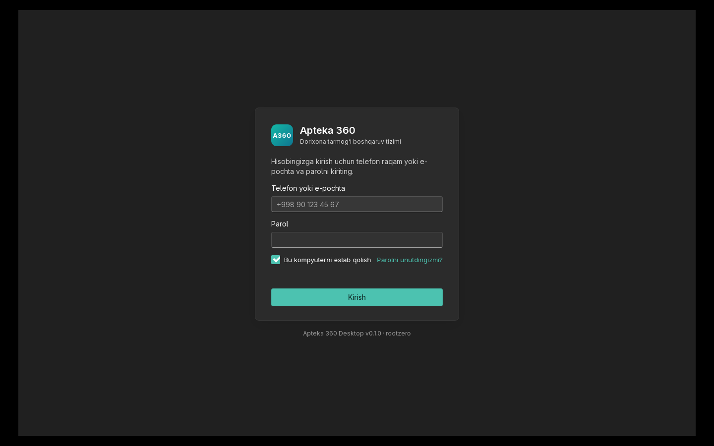
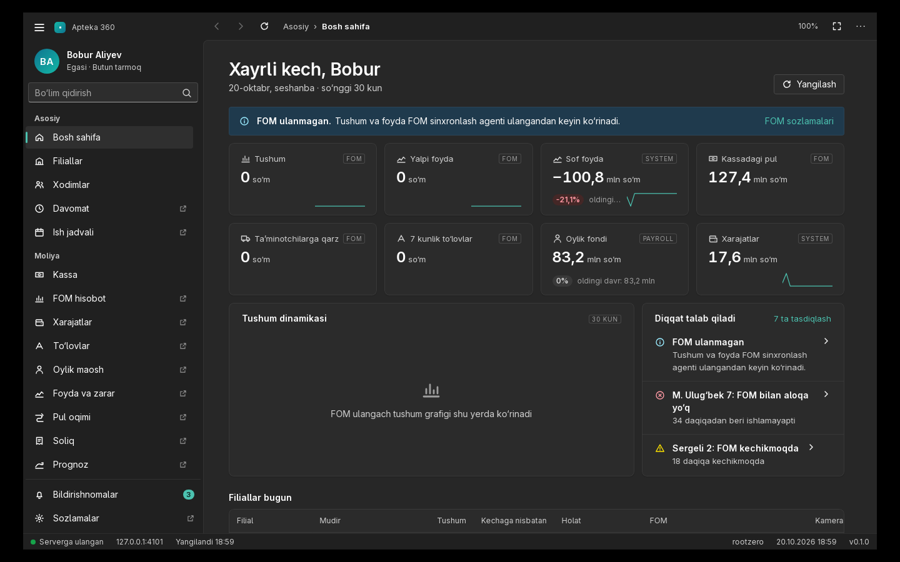
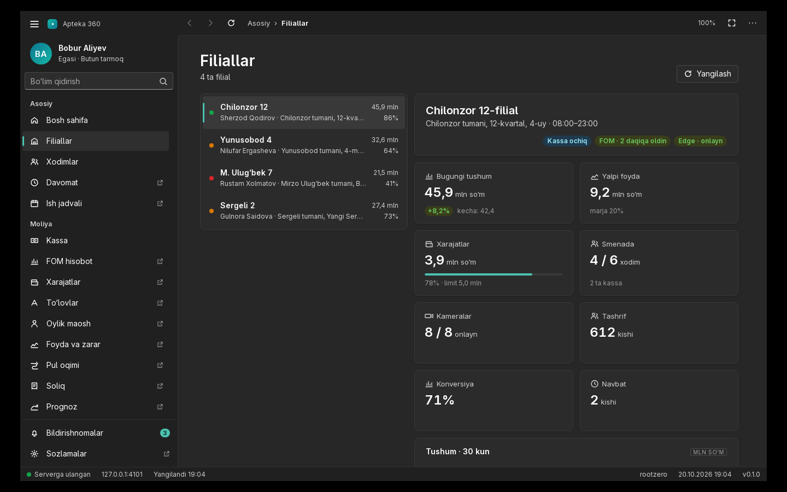
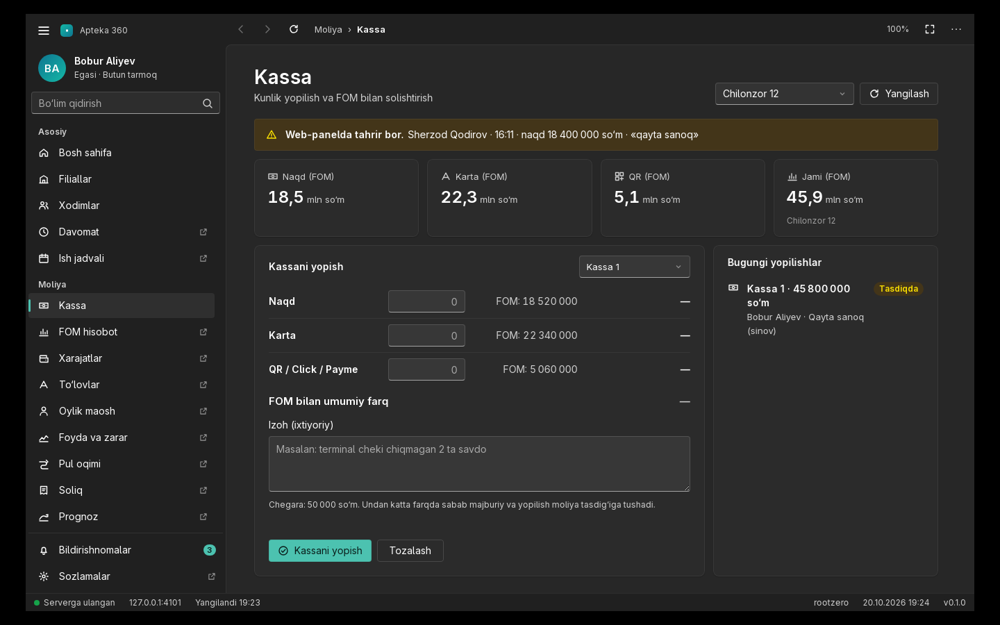
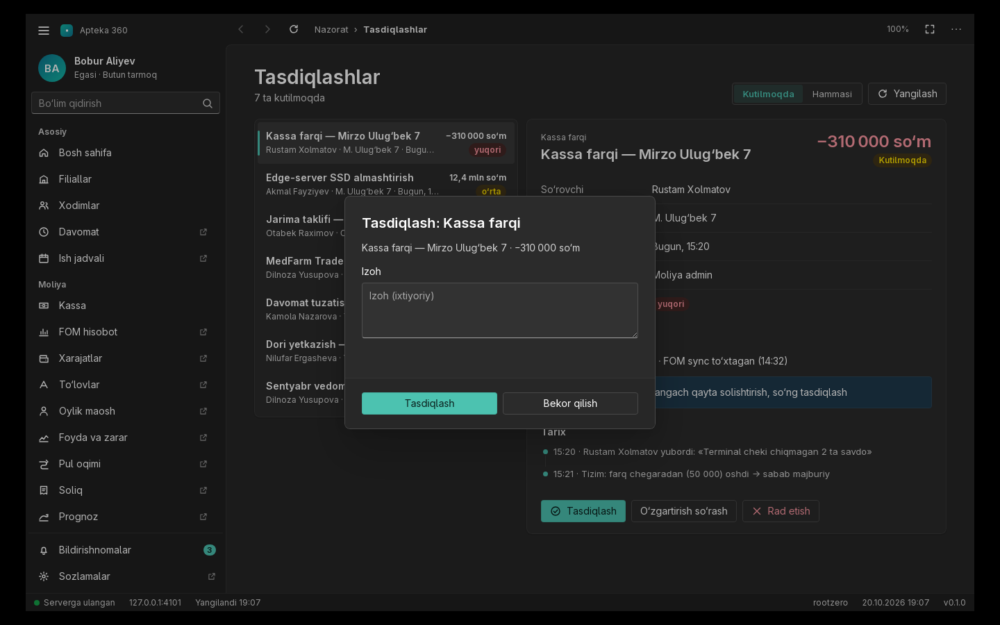
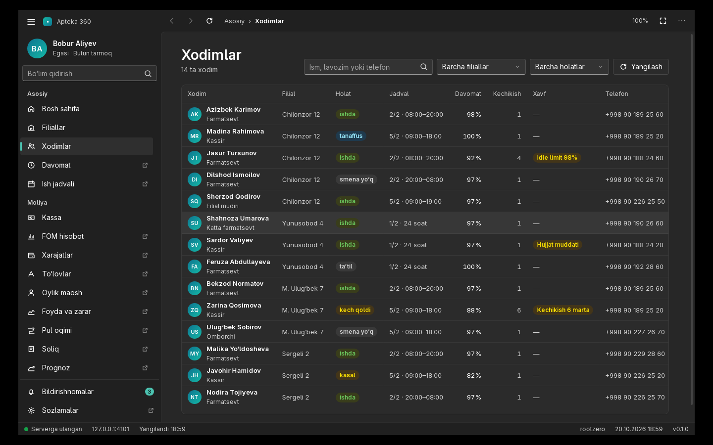
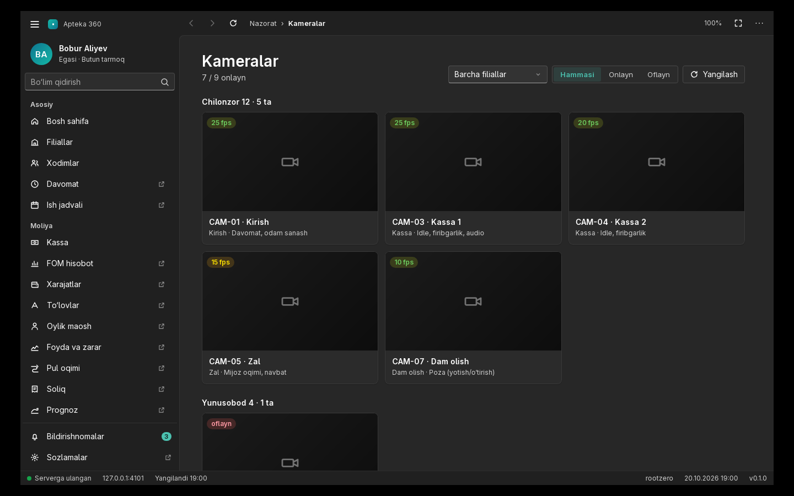
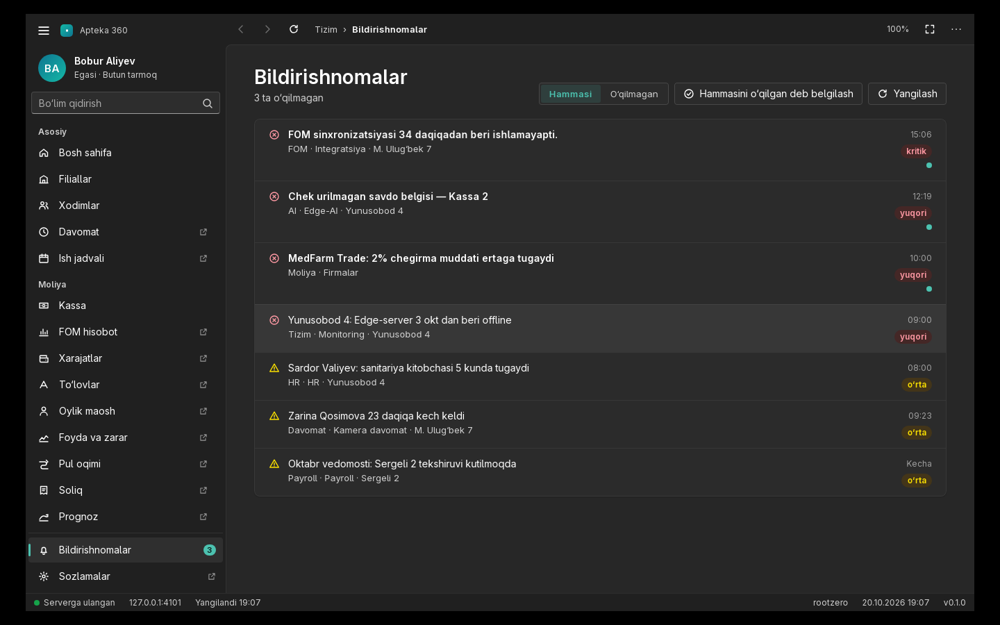
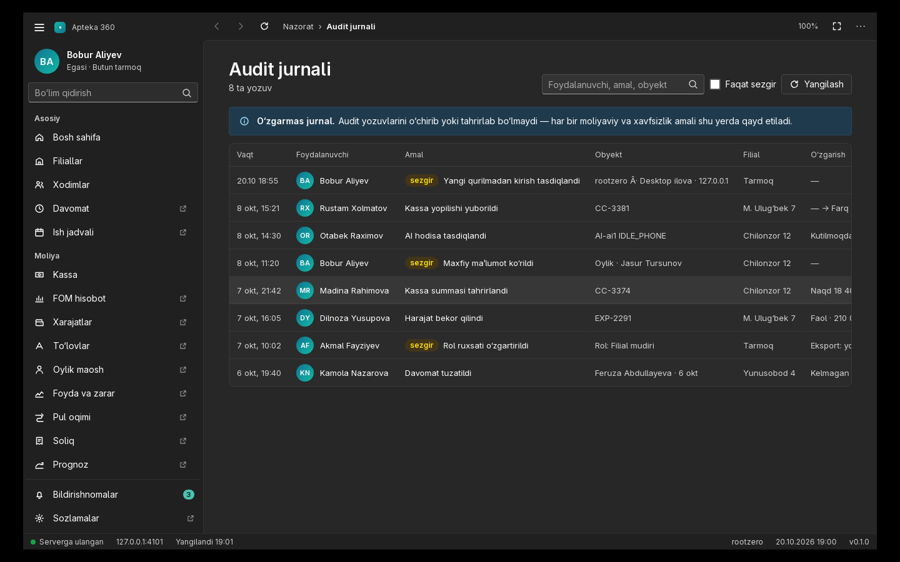

# Apteka 360 — Desktop ilova (Windows / Linux)

Apteka 360 dorixona tarmog‘i boshqaruv tizimining **native desktop ilovasi**. [Tauri 2](https://tauri.app) asosida,
Windows 11 Fluent Design uslubida: o‘z kirish oynasi, navigatsiya paneli, buyruqlar va holat paneli, Windows dialoglari.
Asosiy ekranlar ilovaning o‘zida chiziladi va ma’lumotni **to‘g‘ridan-to‘g‘ri API’dan** (`https://api-apteka.agrom24.uz`) oladi;
kam ishlatiladigan bo‘limlar hozircha web paneldan (`https://apteka.agrom24.uz`) ilova ichida ochiladi.

## Skrinshotlar (Linux build, Xvfb, lokal dev API bilan)

| Kirish | Bosh sahifa | Filiallar |
|---|---|---|
|  |  |  |
| **Kassa (yopilish → «Tasdiqda»)** | **Tasdiqlash dialogi** | **Xodimlar** |
|  |  |  |
| **Kameralar** | **Bildirishnomalar** | **Audit jurnali** |
|  |  |  |

## Native ekranlar

| Ekran | Nima qiladi | API |
|---|---|---|
| **Kirish** | login/parol → Telegram/SMS kod → yangi qurilmani tasdiqlash; parolni tiklash | `/v1/auth/*` |
| **Bosh sahifa** | salomlashish, KPI kartalari (tushum, foyda, kassa, oylik fondi, xarajatlar… + sparkline), 30 kunlik tushum grafigi, ogohlantirishlar, filiallar jadvali, pul zaxirasi prognozi | `/v1/dashboard`, `/v1/branches`, `/v1/approvals` |
| **Filiallar** | ro‘yxat + tafsilot: tushum (kechaga nisbatan), yalpi foyda, xarajat limiti, smena, kameralar, tashrif, konversiya, 30 kunlik grafik | `/v1/branches` |
| **Xodimlar** | jadval, qidiruv, filial/holat filtri, xodim kartasi (oylik maydonlari rolga qarab) | `/v1/employees` |
| **Kassa** | FOM bo‘yicha bugungi naqd/karta/QR, **kassani yopish** (FOM bilan farq, chegara, majburiy sabab), ziddiyat (409) dialogi, bugungi yopilishlar | `/v1/fomCashToday`, `/v1/settings`, `/v1/desktop`, `desk.cashClose`, `desk.resolveConflict` |
| **Kameralar** | filial bo‘yicha guruhlangan kameralar, jonli ko‘rish (HLS, hls.js), SD/HD, **ovoz**, bosib turib **gapirish** (mikrofon → Edge) | `/v1/cameras`, `cameras.streamUrl`, `cameras.talk` |
| **Tasdiqlashlar** | ro‘yxat + tafsilot (dalil, tavsiya, tarix), Tasdiqlash / O‘zgartirish so‘rash / Rad etish (izoh dialogi) | `/v1/approvals`, `approvals.decide` |
| **Bildirishnomalar** | muhimlik bo‘yicha, o‘qilmaganlar soni nav-panelda (badge), o‘qilgan deb belgilash | `/v1/notifications`, `notifications.markRead|markAllRead` |
| **Audit jurnali** | o‘zgarmas jurnal, qidiruv, «faqat sezgir» filtri | `/v1/audit` |

Web paneldan ochiladigan bo‘limlar (nav-panelda ↗ belgisi): Davomat, Ish jadvali, FOM hisobot, Xarajatlar, To‘lovlar, Oylik,
Foyda va zarar, Pul oqimi, Soliq, Prognoz, Video devor, AI hodisalar, Muddatlar, Ta’minotchilar, Shifokorlar, Hisobotlar,
Analitika, Sozlamalar. Ular bosqichma-bosqich native ekranlarga o‘tkaziladi (`ui/screens.js` ga yangi ekran + `NAV` da `native: true`).

## Arxitektura

```
┌ Window «Apteka 360» (native sarlavha, menyu, tray) ───────────────────────────┐
│ ☰ Apteka 360        │ ‹ › ⟳  Moliya › Kassa                    100%  ⛶  ⋯   │ ← buyruqlar paneli
│ (BA) Bobur Aliyev   │──────────────────────────────────────────────────────── │
│ [Bo‘lim qidirish ]  │                                                         │
│ Asosiy              │   webview «shell» — ui/ (native ekranlar, kirish,       │
│  Bosh sahifa        │   offline, dialoglar)  ── Rust `api` ──► API             │
│  Filiallar …        │                                                         │
│ Moliya ↗ …          │   webview «panel» — web panel (faqat ↗ bo‘limlar,       │
│ Bildirishnomalar (3)│   yashirin holatda sessiya cookie’sini saqlaydi)        │
│ ● Serverga ulangan  api-apteka.agrom24.uz  Yangilandi 19:22   KASSA-PC  v0.1.0  │ ← holat paneli
└─────────────────────────────────────────────────────────────────────────────────┘
```

- **Ikki child-webview** (Tauri 2 multiwebview): `shell` — lokal `ui/` (`index.html`, `app.css`, `app.js` — yadro, `screens.js` — ekranlar,
  `vendor/hls.light.min.js`); `panel` — web panel, faqat web bo‘lim tanlanganda ko‘rinadi.
- **Sessiya:** kirish so‘rovlari `panel_api` ko‘prigi orqali panel kontekstida (origin `apteka.agrom24.uz`) bajariladi, shuning uchun
  httpOnly refresh-cookie web paneldagidek saqlanadi (keyingi ishga tushishda avtomatik kiradi). Access token panel init-skriptida
  ushlanadi (`report_token`) va Rust xotirasida turadi; native ekranlar API’ga Rust (`api` buyrug‘i, reqwest) orqali murojaat qiladi —
  har so‘rovda `Authorization`, `X-Client: desktop/<versiya>`, `X-Client-Device: <kompyuter> - Desktop ilova`, buyruqlarda `Idempotency-Key`.
  401 → ko‘prik orqali refresh → qayta urinish; refresh ham 401 → kirish oynasi. Token diskka yozilmaydi.
- **Native boshqaruv:** «⋯» va hisob kartasi — Windows kontekst menyusi (Bosh sahifa, Qayta yuklash, Brauzerda ochish, Windows bilan
  ishga tushirish, Yopganda trayga yig‘ish, To‘liq ekran, Dastur haqida, Hisobdan chiqish, Chiqish). Tray ikonkasi, bitta nusxa, oyna holati.
- **Klaviatura:** `Ctrl+F` bo‘lim qidirish, `Ctrl+B` nav-panel, `F5`/`Ctrl+R` yangilash, `Alt+←/→` orqaga/oldinga, `Alt+Home` bosh sahifa,
  `Ctrl+±/0` masshtab, `F11` to‘liq ekran, `Ctrl+Q` chiqish. Och/to‘q mavzu Windows sozlamasiga qarab.
- **Linux cheklovi:** WebKitGTK’da child-webview pozitsiyasi ishlamaydi — Linux’da web bo‘lim ochilganda panel butun oynani egallaydi
  (pastki chapdagi «◂ Apteka 360» tugmasi ilovaga qaytaradi). Native ekranlar Linux’da ham to‘liq ishlaydi.

## Imkoniyatlar (qobiq)

| Imkoniyat | Qayerda |
|---|---|
| Oyna «Apteka 360», ikonka, 1366×860 (minimal 1280×800), o‘lcham/joy eslab qolinadi | `src-tauri/src/lib.rs` → `setup`, `tauri-plugin-window-state` |
| Tray ikonkasi, yopganda trayga yig‘ish, bitta nusxa, Windows bilan ishga tushish | `lib.rs` → `build_tray`, single-instance, autostart |
| Offline: o‘zbekcha ekran, «Qayta urinish», 15 s da avtomatik qayta urinish | `ui/app.js` → `setConn` |
| Kamera ovozi va «Gapirish»: mikrofon/autoplay ruxsati (shell va panel domeni uchun) | `lib.rs` → `on_permission_request` |
| Avto-yangilanish uchun joy (`updater` feature) | `lib.rs` → `mod updater`, `src-tauri/tauri.updater.conf.json` |
| Windows EXE (NSIS, rus/ingliz) + MSI, Linux `.deb` / `.rpm` / `.AppImage` | `.github/workflows/build.yml`, `docker/build.sh` |

### X-Client sarlavhalari

`docs/API-MOBILE-DESKTOP.md` (backend) talabi: native ekranlarning barcha so‘rovlari Rust orqali ketadi va ikkala sarlavha har doim
qo‘shiladi. Web panel ichidagi so‘rovlarga init-skript (`src-tauri/src/inject.js`) fetch/XHR’ni o‘rab qo‘shadi (CORS ruxsat beradi).
Cheklov: web panelning ``/`<video>`/HLS so‘rovlariga va dastlabki HTML navigatsiyaga sarlavha qo‘shib bo‘lmaydi.
`X-Client-Device` faqat ASCII (`KASSA-PC-01 - Desktop ilova`): «·» belgisi HTTP sarlavhada buziladi.

## Tayyor artefaktlar (lokal build, 2026-10-20)

Build Docker ichida (`docker/build.sh`), natijalar `dist/` da (`.gitignore` da — repoga kirmaydi):

| Fayl | Izoh |
|---|---|
| `dist/windows/Apteka 360_0.1.0_x64-setup.exe` | **Windows o‘rnatuvchi** (NSIS, x64), Linux’da `cargo-xwin` bilan cross-compile, imzolanmagan |
| `dist/windows/apteka360-desktop.exe` | o‘rnatuvchisiz ilova (portable; WebView2 runtime kerak) |
| `dist/linux/Apteka 360_0.1.0_amd64.deb` / `.rpm` | Linux |

MSI faqat GitHub Actions (`windows-latest`) orqali chiqadi.

## Loyiha tuzilmasi

```
apteka360-desktop/
├─ ui/                           # native qobiq (webview «shell»)
│  ├─ index.html, app.css        # tuzilma va Fluent uslublari (och/to‘q)
│  ├─ app.js                     # yadro: navigatsiya, sessiya, API, dialog/toast, kirish
│  ├─ screens.js                 # ekranlar: dashboard, branches, employees, cash, cameras, approvals, notifications, audit
│  └─ vendor/hls.light.min.js    # hls.js 1.5.20 (Apache-2.0, vendor/hls.LICENSE)
├─ src-tauri/
│  ├─ Cargo.toml                 # Rust bog‘liqliklari; `updater` feature
│  ├─ tauri.conf.json            # bundle (nsis, msi, deb, rpm, appimage), ikonkalar
│  ├─ tauri.updater.conf.json    # avto-yangilanish konfiguratsiyasi (--config bilan ulanadi)
│  ├─ capabilities/              # shell.json (lokal qobiq), remote.json (apteka.agrom24.uz)
│  └─ src/{main.rs,lib.rs,inject.js}
├─ docs/test/                    # sinov: fake-panel.py (web panel taqlidi), no-hsts-proxy.py, media-test.html
├─ docker/                       # Linux’da Docker orqali build (sudo kerak emas)
└─ .github/workflows/build.yml   # GitHub Actions: windows-latest (EXE+MSI) va ubuntu (deb/rpm/AppImage)
```

## Lokal sinov (dev API bilan)

```bash
# 1) backend: apteka360-backend/apps/api — seed rejimi, OTP 123456
PORT=4100 HOST=127.0.0.1 CORS_ORIGINS=http://127.0.0.1:4200 ../../node_modules/.bin/tsx src/main.ts
# 2) HSTS sarlavhasini olib tashlovchi proksi va web panel taqlidi
python3 -I docs/test/no-hsts-proxy.py 4101 127.0.0.1:4100
python3 -I docs/test/fake-panel.py http://127.0.0.1:4101
# 3) sinov build (faqat .deb) va avtomatik kirish (owner@apteka360.uz)
BUNDLES=deb APTEKA_PANEL_URL=http://127.0.0.1:4200 APTEKA_API_URL=http://127.0.0.1:4101 docker/build.sh linux
APTEKA_DEBUG=1 APTEKA_SELFTEST=1 APTEKA_SELFTEST_ROUTE=cash docker/.cache/target/release/apteka360-desktop
```

`APTEKA_SELFTEST*` va `APTEKA_DEBUG` faqat diagnostika uchun (dev OTP faqat `NODE_ENV != production` serverda ishlaydi).

## Build

### 1-usul: GitHub Actions (tavsiya — Windows EXE **va** MSI)

Repo GitHub’ga push qilinganda `.github/workflows/build.yml` ishga tushadi:

- `windows-latest` → `Apteka 360_<ver>_x64-setup.exe` (NSIS) va `Apteka 360_<ver>_x64_en-US.msi` (WiX);
- `ubuntu-22.04` → `.deb`, `.rpm`, `.AppImage`.

Natijalar: Actions → tegishli run → **Artifacts** (`apteka360-desktop-windows-x64`, `apteka360-desktop-linux-x64`).
`v*` teg push qilinsa (masalan `git tag v0.1.0 && git push --tags`) qo‘shimcha ravishda **draft GitHub Release** yaratiladi.

### 2-usul: Linux’da lokal (Docker, sudo talab qilmaydi)

Talablar: Docker (foydalanuvchi `docker` guruhida). Rust, Node, npm o‘rnatish shart emas — hammasi image ichida.

```bash
docker/build.sh image      # builder image (Rust + WebKitGTK + cargo-xwin + NSIS + Tauri CLI), bir marta
docker/build.sh icons      # assets/app-icon.png → src-tauri/icons/* (ikonka o‘zgarganda)
docker/build.sh linux      # → dist/linux/*.deb, *.rpm, *.AppImage, apteka360-desktop (binar)
docker/build.sh windows    # → dist/windows/Apteka 360_<ver>_x64-setup.exe (NSIS, cargo-xwin cross-compile)
```

Cross-compile `cargo-xwin` orqali MSVC targetga (`x86_64-pc-windows-msvc`) qilinadi; birinchi ishga tushishda u Microsoft
CRT/SDK fayllarini (~1 GB) `docker/.cache/home/.xwin` ga yuklab oladi. Linux’da **faqat NSIS EXE** chiqadi — MSI (WiX) uchun
Windows kerak (1-usul).

Kesh: `docker/.cache/` (cargo registry, target, xwin). `.gitignore` da.

### 3-usul: Windows kompyuterda to‘g‘ridan-to‘g‘ri

Rust (rustup), Visual Studio Build Tools (C++), WebView2 (Win10/11 da bor). Node shart emas:

```powershell
cargo install tauri-cli --version "^2"
cargo tauri build            # src-tauri\target\release\bundle\nsis\*.exe va msi\*.msi
```

### Panel / API manzilini o‘zgartirish

Kompilyatsiya vaqtida: `APTEKA_PANEL_URL=https://staging.example.uz APTEKA_API_URL=https://api-staging.example.uz docker/build.sh linux`
(yoki `cargo tauri build` oldidan shu env). Standart — `https://apteka.agrom24.uz`.

## O‘rnatish (Windows)

`Apteka 360_<ver>_x64-setup.exe` ni ishga tushiring — joriy foydalanuvchi uchun o‘rnatadi (admin huquqi shart emas),
Start menyu va ish stoliga yorliq qo‘yadi. WebView2 runtime yo‘q bo‘lsa (eski Windows 10), o‘rnatuvchi uni
Microsoft’dan jimgina yuklab o‘rnatadi (internet kerak). MSI — korporativ tarqatish (GPO/Intune) uchun.

Imzolanmagan EXE: Windows SmartScreen «Noma’lum nashriyotchi» deb ogohlantiradi («Батафсил → Baribir ishga tushirish»).
Yo‘qotish uchun Code Signing sertifikati kerak (README oxiridagi «Sirlar» bo‘limi).

## Avto-yangilanish (tayyorlab qo‘yilgan, standart holatda o‘chiq)

Kod `tauri-plugin-updater` bilan ishlaydi, lekin **imzo kaliti** bo‘lmagani uchun `updater` feature standart buildda yoqilmagan.
Yoqish tartibi:

1. Kalit juftligini yarating (bir marta, **xavfsiz joyda** saqlang; repoga yozmang):
   ```bash
   docker/build.sh shell
   cargo tauri signer generate -w /home/builder/apteka360.key      # ~/.cache/home/apteka360.key va .pub
   ```
2. `src-tauri/tauri.updater.conf.json` dagi `"pubkey": "PASTE_PUBLIC_KEY_HERE"` o‘rniga `.pub` fayl mazmunini qo‘ying
   (ochiq kalit — repoga yozsa bo‘ladi). `endpoints` — `latest.json` manzili (standart: `https://apteka.agrom24.uz/desktop/latest.json`;
   GitHub Releases ishlatilsa `https://github.com/<org>/<repo>/releases/latest/download/latest.json`).
3. Build:
   ```bash
   TAURI_SIGNING_PRIVATE_KEY="$(cat kalit)" TAURI_SIGNING_PRIVATE_KEY_PASSWORD="..." \
     docker/build.sh windows -- --features updater --config src-tauri/tauri.updater.conf.json
   ```
   GitHub Actions’da: repo Secrets ga `TAURI_SIGNING_PRIVATE_KEY` va `TAURI_SIGNING_PRIVATE_KEY_PASSWORD` qo‘ying,
   workflow’dagi `args` ga `--features updater --config src-tauri/tauri.updater.conf.json` qo‘shing. `includeUpdaterJson: true`
   bo‘lgani uchun Release’ga `latest.json` ham chiqadi.
4. Ilova ishga tushganda `latest.json` ni tekshiradi; yangi versiya bo‘lsa «Yangilash / Keyinroq» dialogi, so‘ng
   yuklab o‘rnatadi va qayta ishga tushadi (`lib.rs` → `mod updater`).

## Sirlar (repoga yozilmaydi)

| Sir | Nima uchun | Qayerda saqlanadi |
|---|---|---|
| `TAURI_SIGNING_PRIVATE_KEY` (+ `_PASSWORD`) | updater artefaktlarini imzolash | GitHub Secrets / lokal env |
| Code Signing sertifikati (`.pfx`) + paroli | SmartScreen ogohlantirishini olib tashlash (ixtiyoriy) | GitHub Secrets; `tauri.conf.json → bundle.windows.certificateThumbprint` |

`.gitignore` da `*.key`, `.env*`, `dist/`, `docker/.cache/` bor.

## Kamera ovozi va «Gapirish» (0.1.0+)

Web panelning kamera ekranida «Ovoz» (HLS oqimdagi audio) va «Gapirish» (push-to-talk: `getUserMedia({audio})` → Edge → Hikvision
two-way audio) tugmalari bor. Desktop qobiqda buning uchun:

- `WebviewWindowBuilder::on_permission_request` — `Microphone`, `Camera`, `Autoplay` so‘rovlari **faqat** panel domeni
  (`APTEKA_PANEL_URL` hosti yoki `*.agrom24.uz`) uchun avtomatik ruxsat etiladi; boshqa sahifalar uchun platforma standarti
  (Windows — WebView2 dialogi, Linux — rad). Windows WebView2 va Linux WebKitGTK ikkalasida ishlaydi (Tauri 2.12).
- Autoplay: wry standart holatda WebView2 ga `--autoplay-policy=no-user-gesture-required`, WebKitGTK ga `AutoplayPolicy::Allow` beradi;
  panel baribir tugma bosilgandan keyin ovoz yoqadi.
- Secure context: panel `https://` — `getUserMedia` mavjud. Mikrofon qurilmasi Windows’da «Sozlamalar → Maxfiylik → Mikrofon» da
  desktop ilovalarga ruxsat etilgan bo‘lishi kerak, aks holda `NotAllowedError`/`NotFoundError` qaytadi.
- Lokal sinov sahifasi: `docs/test/media-test.html` (`APTEKA_PANEL_URL=http://127.0.0.1:8088/media-test.html docker/build.sh linux`).

## Ma’lum cheklovlar

- **Windows’da real sinov qilinmagan:** EXE Linux’da cross-compile qilingan; native ekranlar, kirish va kassa yopish Linux build’da
  lokal dev API bilan oxirigacha sinalgan. Windows’da child-webview joylashuvi (web bo‘limlar) va WebView2 mikrofon dialogi tekshirilishi kerak.
- Kamera jonli ko‘rish va «Gapirish» haqiqiy kamera/Edge bilan sinalmagan (lokal seed’da `cameras` moduli o‘chiq).
- Kassa yopishning oflayn navbati (SQLite, `docs/API-MOBILE-DESKTOP.md` 3.4) hali yo‘q: aloqa bo‘lmasa yopish yuborilmaydi va xato ko‘rsatiladi.
- Ko‘p bo‘limlar hali web paneldan ochiladi (↗). Ular native ekranlarga bosqichma-bosqich o‘tkaziladi.
- EXE imzolanmagan (SmartScreen ogohlantiradi); MSI faqat CI’dan.
