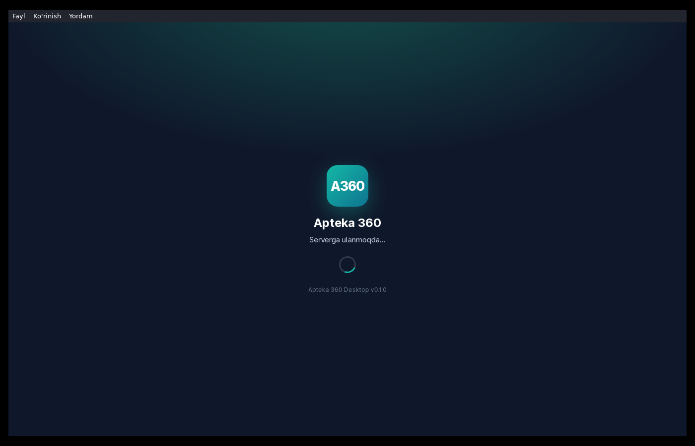
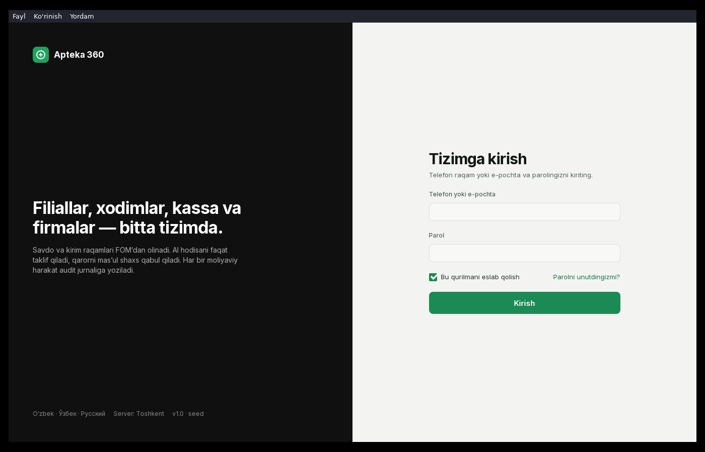
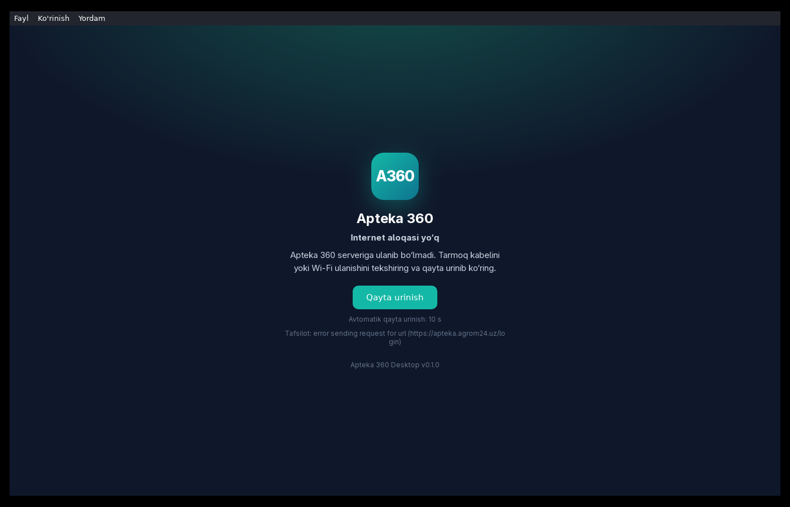

# Apteka 360 — Desktop ilova (Windows / Linux)

Apteka 360 dorixona tarmog‘i boshqaruv tizimining desktop qobig‘i. [Tauri 2](https://tauri.app) asosida qurilgan,
**https://apteka.agrom24.uz** web panelini tizim WebView’ida (Windows — WebView2, Linux — WebKitGTK) ochadi.
Ilova o‘zida frontend kodini saqlamaydi: panel yangilanganda desktop ilovani qayta chiqarish shart emas.

## Imkoniyatlar

| Imkoniyat | Qayerda |
|---|---|
| Oyna «Apteka 360», ikonka, 1366×860 (minimal 1280×800), markazda; oyna o‘lchami/joyi eslab qolinadi | `src-tauri/src/lib.rs` → `setup`, `tauri-plugin-window-state` |
| Tizim tray ikonkasi («Apteka 360 ni ochish», «Chiqish»); oynani yopganda trayga yig‘iladi (Fayl → «Yopganda trayga yig‘ish» bilan o‘chiriladi) | `lib.rs` → `build_tray` |
| Bitta nusxa: ikkinchi marta ochilsa mavjud oyna ko‘tariladi | `tauri-plugin-single-instance` |
| Windows bilan avtomatik ishga tushish (Fayl menyusida belgi) | `tauri-plugin-autostart` |
| O‘zbek/rus/ingliz tilidagi NSIS o‘rnatuvchi, WebView2 bootstrapper ichida | `tauri.conf.json → bundle.windows` |
| Menyu: Fayl (Bosh sahifa `Alt+Home`, Qayta yuklash `Ctrl+R`, Chiqish `Ctrl+Q`), `Alt+←/→` orqaga/oldinga, Ko‘rinish (Kattalashtirish `Ctrl+=`, Kichraytirish `Ctrl+-`, Asl o‘lcham `Ctrl+0`, To‘liq ekran `F11`), Yordam | `src-tauri/src/lib.rs` → `build_menu` |
| Offline bo‘lsa o‘zbekcha xato ekrani, «Qayta urinish» tugmasi, 15 s da avtomatik qayta urinish | `ui/index.html` (ishga tushishda), `src-tauri/src/inject.js` (panel ichida aloqa uzilsa overlay) |
| API so‘rovlariga `X-Client: desktop/<versiya>` va `X-Client-Device: <kompyuter nomi> · Desktop ilova` | `src-tauri/src/inject.js` (fetch/XHR), `lib.rs` (dastlabki navigatsiya sarlavhalari) |
| Avto-yangilanish uchun joy (`updater` feature) | `lib.rs` → `mod updater`, `src-tauri/tauri.updater.conf.json` |
| Windows EXE (NSIS) + MSI, Linux `.deb` / `.rpm` / `.AppImage` | `.github/workflows/build.yml`, `docker/build.sh` |

### X-Client sarlavhasi qanday qo‘shiladi

`docs/API-MOBILE-DESKTOP.md` (backend) har so‘rovda `X-Client: desktop/<versiya>` va `X-Client-Device` talab qiladi.
Web panel kodi desktop haqida bilmaydi, shuning uchun ilova har bir sahifaga **init-skript** kiritadi
(`src-tauri/src/inject.js`): u `window.fetch` va `XMLHttpRequest` ni o‘rab, `*.agrom24.uz` ga ketayotgan har bir
so‘rovga ikkala sarlavhani qo‘shadi. API CORS allow-list’ida bu sarlavhalar bor (preflight tekshirilgan:
`access-control-allow-headers: ... X-Client, X-Client-Device ...`), shuning uchun brauzer ularni o‘tkazadi.

**Cheklovlar:**
- Tauri 2.12 da dastlabki (HTML) navigatsiya so‘roviga maxsus sarlavha qo‘shish API’si yo‘q; sarlavhalar faqat JS so‘rovlarida.
- Sarlavhalar web panelning *JS orqali* yuboradigan so‘rovlariga qo‘shiladi. Agar panel ``, `<video>`, HLS segmentlari
  yoki Service Worker orqali API ga murojaat qilsa, ularga sarlavha qo‘shilmaydi (brauzer imkon bermaydi).
- Agar web panel fetch’ni sahifa yuklanishidan *oldin* o‘z nusxasiga saqlab olsa (odatda bunday emas), o‘rash ishlamaydi.
- Panelning o‘zi (`window.__APTEKA_DESKTOP__` obyekti bor) desktop ichida ekanini aniqlab, sarlavhani o‘zi qo‘shishi ham mumkin —
  bu eng ishonchli yo‘l; init-skript mavjud sarlavhani qayta yozmaydi.

## Skrinshotlar (Linux build, Xvfb)

| Yuklanish | Login ekrani | Offline |
|---|---|---|
|  |  |  |

## Tayyor artefaktlar (lokal build, 2026-10-18)

Build Docker ichida qilingan (`docker/build.sh`), natijalar `dist/` da (`.gitignore` da — repoga kirmaydi):

| Fayl | Hajm | Izoh |
|---|---|---|
| `dist/windows/Apteka 360_0.1.0_x64-setup.exe` | 2.2 MB | **Windows o‘rnatuvchi** (NSIS, x64), Linux’da `cargo-xwin` bilan cross-compile qilingan, imzolanmagan |
| `dist/windows/apteka360-desktop.exe` | 7 MB | o‘rnatuvchisiz ilova (portable; WebView2 runtime kerak) |
| `dist/linux/Apteka 360_0.1.0_amd64.deb` / `.rpm` / `.AppImage` | 3.3 / 3.3 / 104 MB | Linux |

MSI faqat GitHub Actions (`windows-latest`) orqali chiqadi.

## Loyiha tuzilmasi

```
apteka360-desktop/
├─ ui/index.html                 # lokal loader: ulanishni tekshiradi, keyin panelga o‘tadi; offline ekrani
├─ src-tauri/
│  ├─ Cargo.toml                 # Rust bog‘liqliklari; `updater` feature
│  ├─ tauri.conf.json            # oyna, bundle (nsis, msi, deb, rpm, appimage), ikonkalar
│  ├─ tauri.updater.conf.json    # avto-yangilanish konfiguratsiyasi (--config bilan ulanadi)
│  ├─ capabilities/              # ruxsatlar: default.json (lokal sahifa), remote.json (apteka.agrom24.uz)
│  ├─ icons/                     # `cargo tauri icon` yaratgan ikonkalar (.ico, .icns, .png)
│  └─ src/{main.rs,lib.rs,inject.js}
├─ assets/app-icon.png           # manba ikonka (1024×1024)
├─ docker/                       # Linux’da Docker orqali build (sudo kerak emas)
│  ├─ Dockerfile.builder
│  └─ build.sh
└─ .github/workflows/build.yml   # GitHub Actions: windows-latest (EXE+MSI) va ubuntu (deb/rpm/AppImage)
```

## Build

### 1-usul: GitHub Actions (tavsiya — Windows EXE **va** MSI)

Repo GitHub’ga push qilinganda `.github/workflows/build.yml` ishga tushadi:

- `windows-latest` → `Apteka 360_<ver>_x64-setup.exe` (NSIS) va `Apteka 360_<ver>_x64_en-US.msi` (WiX);
- `ubuntu-22.04` → `.deb`, `.rpm`, `.AppImage`.

Natijalar: Actions → tegishli run → **Artifacts** (`apteka360-desktop-windows-x64`, `apteka360-desktop-linux-x64`).
`v*` teg push qilinsa (masalan `git tag v0.1.0 && git push --tags`) qo‘shimcha ravishda **draft GitHub Release** yaratiladi.

### 2-usul: Linux’da lokal (Docker, sudo talab qilmaydi)

Talablar: Docker (foydalanuvchi `docker` guruhida). Rust, Node, npm o‘rnatish shart emas — hammasi image ichida.

```bash
docker/build.sh image      # builder image (Rust + WebKitGTK + cargo-xwin + NSIS + Tauri CLI), bir marta
docker/build.sh icons      # assets/app-icon.png → src-tauri/icons/* (ikonka o‘zgarganda)
docker/build.sh linux      # → dist/linux/*.deb, *.rpm, *.AppImage, apteka360-desktop (binar)
docker/build.sh windows    # → dist/windows/Apteka 360_<ver>_x64-setup.exe (NSIS, cargo-xwin cross-compile)
```

Cross-compile `cargo-xwin` orqali MSVC targetga (`x86_64-pc-windows-msvc`) qilinadi; birinchi ishga tushishda u Microsoft
CRT/SDK fayllarini (~1 GB) `docker/.cache/home/.xwin` ga yuklab oladi. Linux’da **faqat NSIS EXE** chiqadi — MSI (WiX) uchun
Windows kerak (1-usul).

Kesh: `docker/.cache/` (cargo registry, target, xwin). `.gitignore` da.

### 3-usul: Windows kompyuterda to‘g‘ridan-to‘g‘ri

Rust (rustup), Visual Studio Build Tools (C++), WebView2 (Win10/11 da bor). Node shart emas:

```powershell
cargo install tauri-cli --version "^2"
cargo tauri build            # src-tauri\target\release\bundle\nsis\*.exe va msi\*.msi
```

### Panel manzilini o‘zgartirish

Kompilyatsiya vaqtida: `APTEKA_PANEL_URL=https://staging.example.uz docker/build.sh linux`
(yoki `cargo tauri build` oldidan shu env). Standart — `https://apteka.agrom24.uz`.

## O‘rnatish (Windows)

`Apteka 360_<ver>_x64-setup.exe` ni ishga tushiring — joriy foydalanuvchi uchun o‘rnatadi (admin huquqi shart emas),
Start menyu va ish stoliga yorliq qo‘yadi. WebView2 runtime yo‘q bo‘lsa (eski Windows 10), o‘rnatuvchi uni
Microsoft’dan jimgina yuklab o‘rnatadi (internet kerak). MSI — korporativ tarqatish (GPO/Intune) uchun.

Imzolanmagan EXE: Windows SmartScreen «Noma’lum nashriyotchi» deb ogohlantiradi («Батафсил → Baribir ishga tushirish»).
Yo‘qotish uchun Code Signing sertifikati kerak (README oxiridagi «Sirlar» bo‘limi).

## Avto-yangilanish (tayyorlab qo‘yilgan, standart holatda o‘chiq)

Kod `tauri-plugin-updater` bilan ishlaydi, lekin **imzo kaliti** bo‘lmagani uchun `updater` feature standart buildda yoqilmagan.
Yoqish tartibi:

1. Kalit juftligini yarating (bir marta, **xavfsiz joyda** saqlang; repoga yozmang):
   ```bash
   docker/build.sh shell
   cargo tauri signer generate -w /home/builder/apteka360.key      # ~/.cache/home/apteka360.key va .pub
   ```
2. `src-tauri/tauri.updater.conf.json` dagi `"pubkey": "PASTE_PUBLIC_KEY_HERE"` o‘rniga `.pub` fayl mazmunini qo‘ying
   (ochiq kalit — repoga yozsa bo‘ladi). `endpoints` — `latest.json` manzili (standart: `https://apteka.agrom24.uz/desktop/latest.json`;
   GitHub Releases ishlatilsa `https://github.com/<org>/<repo>/releases/latest/download/latest.json`).
3. Build:
   ```bash
   TAURI_SIGNING_PRIVATE_KEY="$(cat kalit)" TAURI_SIGNING_PRIVATE_KEY_PASSWORD="..." \
     docker/build.sh windows -- --features updater --config src-tauri/tauri.updater.conf.json
   ```
   GitHub Actions’da: repo Secrets ga `TAURI_SIGNING_PRIVATE_KEY` va `TAURI_SIGNING_PRIVATE_KEY_PASSWORD` qo‘ying,
   workflow’dagi `args` ga `--features updater --config src-tauri/tauri.updater.conf.json` qo‘shing. `includeUpdaterJson: true`
   bo‘lgani uchun Release’ga `latest.json` ham chiqadi.
4. Ilova ishga tushganda `latest.json` ni tekshiradi; yangi versiya bo‘lsa «Yangilash / Keyinroq» dialogi, so‘ng
   yuklab o‘rnatadi va qayta ishga tushadi (`lib.rs` → `mod updater`).

## Sirlar (repoga yozilmaydi)

| Sir | Nima uchun | Qayerda saqlanadi |
|---|---|---|
| `TAURI_SIGNING_PRIVATE_KEY` (+ `_PASSWORD`) | updater artefaktlarini imzolash | GitHub Secrets / lokal env |
| Code Signing sertifikati (`.pfx`) + paroli | SmartScreen ogohlantirishini olib tashlash (ixtiyoriy) | GitHub Secrets; `tauri.conf.json → bundle.windows.certificateThumbprint` |

`.gitignore` da `*.key`, `.env*`, `dist/`, `docker/.cache/` bor.

## Ma’lum cheklovlar

- Panel ichida (SPA) aloqa uzilsa overlay `navigator.onLine` hodisalariga tayanadi; Wi‑Fi ulangan, lekin internet yo‘q
  holatda overlay chiqmasligi mumkin — bunda panelning o‘z xato xabari ko‘rinadi, `Ctrl+R` / «Qayta yuklash» loader orqali
  qayta tekshiradi.
- Linux’dan cross-compile qilingan EXE imzolanmagan va MSI bermaydi.
- Kamera jonli ko‘rish panelda HLS (hls.js) orqali — WebView2/WebKitGTK’da MSE bor, qo‘shimcha sozlash kerak emas.
